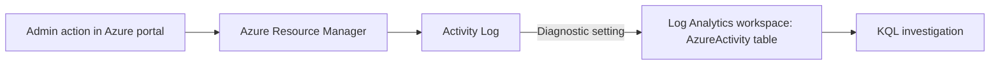

# AI Security Operations & Cloud Security Platform

A hands-on security engineering project on Microsoft Azure: an enterprise-style environment that is built, attacked, detected, investigated, hardened and retested, one version at a time.

## Why this project
Most portfolios show tutorials. This one shows evidence: every version ends with an attack, the telemetry it produced, the detection, the investigation, the fix and a retest.

## Status

| Version | Focus | Status |
|---|---|---|
| v1 | Foundation: cost control, resource organisation, activity logging, first KQL | ✅ Done |
| v2 | Identity and data: RBAC, managed identity, Key Vault, secure storage | Next |
| v3 | Telemetry: endpoint, identity and Linux logs into Microsoft Sentinel | Planned |
| v4 | Detection and investigation: analytics rules, attacks, incident reports | Planned |
| v5–v12 | Hunting, automation, cloud hardening, AI agent security, AI red teaming, governance | Planned |

## v1: Foundation

**What was built**
- A dedicated resource group with tags (project, environment, owner, version) for ownership and cost tracking
- A monthly budget with alerts at 50% and 80% of actual spend and 100% of forecast
- A diagnostic setting that streams the subscription Activity Log into a Log Analytics workspace (Microsoft Sentinel)
- First KQL investigation of my own administrative actions

**Key lessons**
- Budgets alert but do not stop spending, so every lab ends with clean-up
- Diagnostic settings only send events from the moment they are created, so logging must be enabled before anything worth investigating happens
- Azure logs each operation twice (Start and Success), so detections filter on status to avoid double counting
- Activity timestamps are stored in UTC

## Architecture (v1)

## Data and safety
- All data is from my own lab with a fictional company (Contoso). No employer data is used.
- No keys, IDs or personal data are committed. Secret scanning and push protection are enabled.

## Tools
Microsoft Azure · Microsoft Sentinel · Log Analytics · KQL · Microsoft Defender XDR
